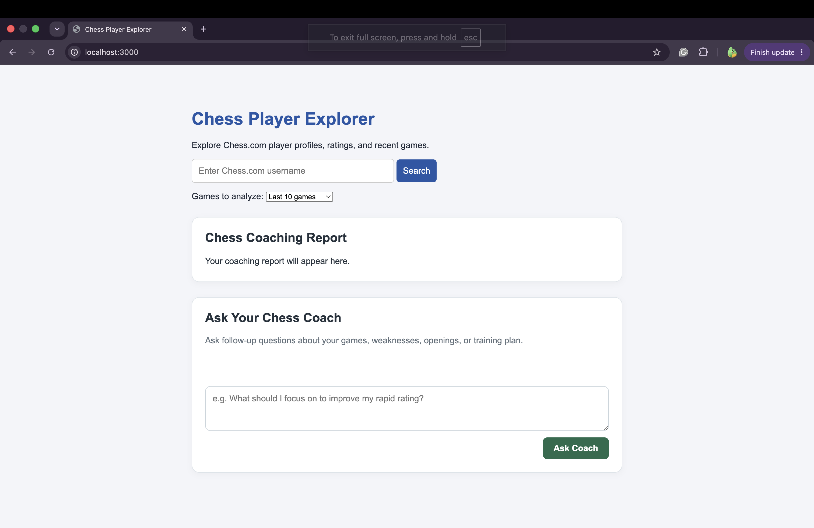

# Web AI Chess.com Coach

An LLM-powered chess analysis and coaching web application that uses Chess.com's public API to retrieve player statistics and recent games, then provides evidence-based feedback to help players improve.

## Demo



## Features

- **Player Statistics:** Pull and display current Bullet, Blitz, Rapid, and Daily ratings.
- **Configurable Game Selection:** Choose how many games to analyze.
- **Performance Analysis:** Summarize results, wins, losses, and draws.
- **AI Coaching:** Querry an LLM(gemini-3.5-flash-lite) to generate personalized improvement suggestions based on available game data.
- **Game History:** Retrieve and review recent Chess.com games.

## Tech Stack

- HTML, CSS, and JavaScript
- Chess.com Public API
- Node.js and Express
- Large language model API for AI coaching (gemini-3.5-flash-lite)

## Getting Started

### Prerequisites

- A modern web browser
- Node.js and npm, if required by your project setup
- An API key for the AI provider used by your application

### Installation

1. Clone the repository:

   ```bash
   git clone https://github.com/Bdan5871/WebAIChessdotcomCoach.git
   cd WebAIChessdotcomCoach
   ```

2. Install dependencies, if your project includes a `package.json`:

   ```bash
   npm install
   ```
   This project was designed on Mac OS. On a windows system it may be necessary to run the following command before `npm install`.
   ```bash
   Set-ExecutionPolicy -Scope CurrentUser -ExecutionPolicy RemoteSigned
   ```

3. If dependencies are not already listed in package.json, install the backend packages:

    ```bash
    npm install express @google/genai dotenv
    ```

3. Create a `.env` file in the project root and configure the API key needed to access the LLM backend. Using gemini this will be GEMINI_API_KEY="Your_API_Key". The API key can be generated by going to 'https://aistudio.google.com/u/1/api-keys'.

4. Ensure your backend loads environment variables and uses the configured Gemini model. For example, server.js can begin with:

`import "dotenv/config";`

Keep your API key on the server. Never commit .env or expose the key in client-side code.

## Configuration

Store API keys and other secrets in environment variables. Never commit `.env` or expose secret API keys in client-side JavaScript.

## Running the Application

If package.json defines a start script for server.js, run:

```
npm start
```

Otherwise, start the server directly:

```
node server.js
```

Open `http://localhost:3000` in your browser, provided the Express server is configured to serve the frontend files on that port.

## Usage

1. Start the application.
2. Enter a valid Chess.com username.
3. Select the number of games to review. If the number of games chosen is 1,000 or ALL the AI is only fed the last 100 in order to avoid payload overload errors.
4. View player statistics, game results, and AI generated feedback.
5. Request additional insights from AI coach by continuing the conversation in the text box.

## Configuration and API Limits

Store API keys in environment variables and keep .env out of version control.

Gemini API usage limits vary by model and account tier. Check your current limits in Google AI Studio.

Generating a new report, changing the number of games analyzed, and sending follow-up messages may each require additional API requests.

## Limitations

Coaching recommendations are based on the game data supplied to the model.

Verified move-by-move blunder analysis requires chess-engine analysis, such as Stockfish, current implementation only pulls observations from existing analysis pulled from Chess.com API

The application requires an internet connection to retrieve Chess.com data and use the Gemini API.

## Troubleshooting

- **Missing API key:** Verify that `GEMINI_API_KEY` is set in
  your `.env` file.
- **API errors or rate limits:** Check your Gemini API quota
  and usage limits in Google AI Studio.
- **Chess.com data not loading:** Verify your internet
  connection and the Chess.com username.
- **Port already in use:** Stop the other process using the
  configured port or change the server port.